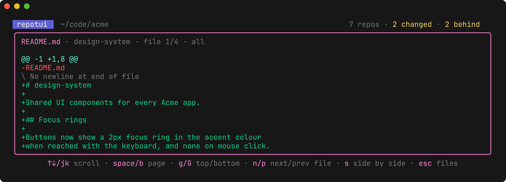
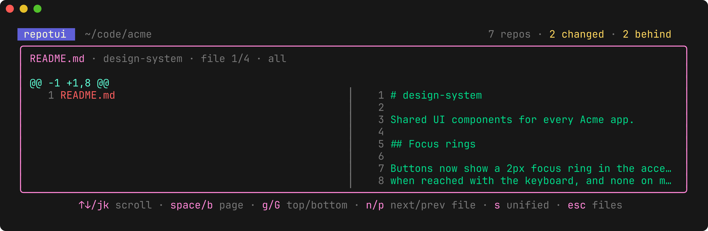

# repotui

A terminal UI for keeping an eye on a folder full of git repos. See every repo's current branch, whether it's ahead or behind, and whether it has uncommitted changes, all on one screen. Switch branches, pull, fetch and stash without `cd`-ing around.


## Features

- **One view of every repo** in a folder, plus any others you list in a `.repotui.conf`: branch, ahead/behind its upstream, number of changed files.
- **Live**: re-reads every repo every 3 seconds, so changes made in your editor or another terminal show up on their own.
- **Switch branches** from a filterable picker that includes branches that only exist on the remote.
- **Pull, fetch, stash and jump to master/main** for one repo or all of them at once.
- **Diff view**: list a repo's changed files and read each one's diff without leaving the app.
- **Search** repos by name or branch, vi-style, and run the "all" actions on just the matches.
- **Activity panel** with the result of each action, including git's own error message when something fails.

## Install

Requires Go 1.27+ and git.

```bash
go install github.com/SandroK0/repotui@latest
```

Or build from source:

```bash
git clone https://github.com/SandroK0/repotui.git
cd repotui
go build -o repotui .
```

## Usage

```bash
repotui ~/code
```

Pass the folder that contains your repos, or run it with no argument from inside that folder. repotui lists every direct subfolder that is a git repo.

### Repos in other places

If some of your repos live somewhere else, list them in a `.repotui.conf` file in the folder you run repotui from:

```
# repos that live outside this folder
~/code/plannr-sdk
sdk = ~/some/other/place/plannr-nuxt-api-sdk
../tools/cli
```

- One repo per line. Add `name =` in front to show it under a different name; otherwise the folder name is used.
- `~` means your home folder, and relative paths are relative to the folder the config is in.
- Blank lines and lines starting with `#` are ignored.
- These repos are listed together with the ones found in the folder, sorted by name. A path that doesn't exist or isn't a git repo shows up in red instead of being skipped.

### Keys

| Key | Action |
| --- | --- |
| `↑` `↓` / `j` `k` | Move between repos |
| `/` | Search repos by name or branch |
| `esc` | Clear the search |
| `enter` / `b` | Open the branch picker for the selected repo |
| `p` / `P` | Pull the selected repo / all repos |
| `f` / `F` | Fetch the selected repo / all repos |
| `m` / `M` | Switch to master or main in the selected repo / all repos |
| `s` / `S` | Stash changes in the selected repo / all repos with changes |
| `n` | Create a new branch in the selected repo |
| `d` | Show the selected repo's changed files and their diffs |
| `r` | Refresh now |
| `q` | Quit |

While a search is active, the "all" keys (`P`, `F`, `M`, `S`) only act on the repos that match.

### Switching branches


Type to filter, `↑` `↓` to move, `enter` to check out. Branches that only exist on the remote are tagged `remote`; checking one out creates a local branch that tracks it.

### Reading diffs



Press `d` on a repo with changes to list its changed files: `M` modified, `A` added, `D` deleted, `R` renamed and `?` untracked. Press `enter` to open a file's diff. Staged and unstaged edits are shown together as one diff against the last commit, and an untracked file is shown as all added lines.

In the diff, `↑` `↓` / `j` `k` scroll, `space` / `b` page, `g` / `G` jump to the top or bottom, and `n` / `p` move to the next or previous file, and `s` switches between the unified view and a side-by-side view with the old file on the left and the new one on the right. The layout you pick stays in place as you move between files. `esc` goes back to the file list, and `esc` again back to the repos. The 3-second refresh doesn't touch an open diff; press `r` in the file list to reload it.



### Searching


## How it behaves

- **Pull** only fast-forwards (`git pull --ff-only`). If your branch has diverged, nothing is merged and the error shows in the activity panel.
- **Fetch** prunes branches that were deleted on the remote.
- **Stash** includes untracked files and labels each stash `repotui <date time>`, so you can find it in `git stash list`.
- **master/main** uses the remote's default branch, falling back to a local `master` or `main`.
- Any git command that takes longer than 60 seconds is stopped and reported as timed out.
- git never prompts for credentials; a command that needs them fails instead of hanging.

## Development

```bash
go test ./...
```

The tests run against throwaway git repos with a local remote, so they need no network and ignore your own git config.

The screenshots above are generated from a folder of fake repos. To regenerate them, install [freeze](https://github.com/charmbracelet/freeze) and run:

```bash
go test -tags screenshots -run TestScreenshots .
```
